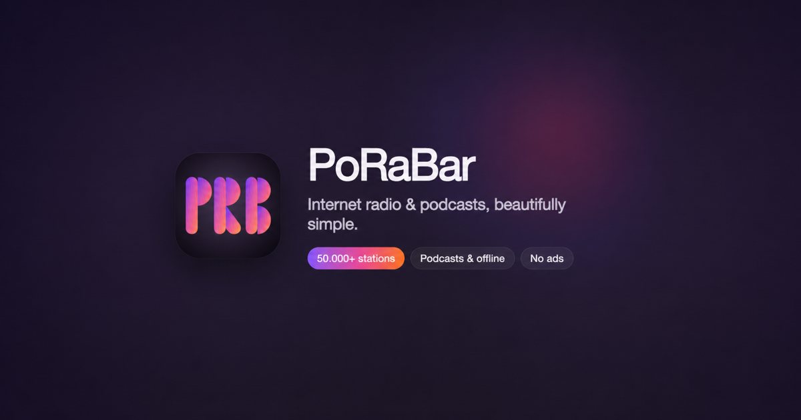
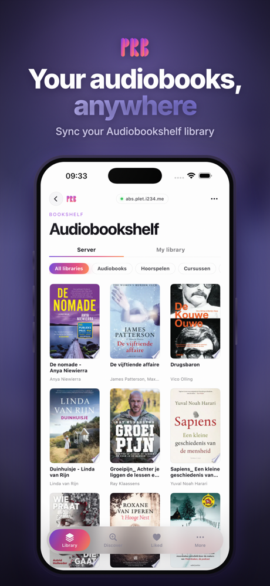
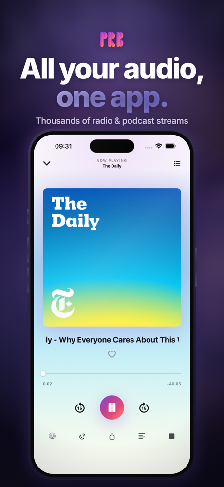
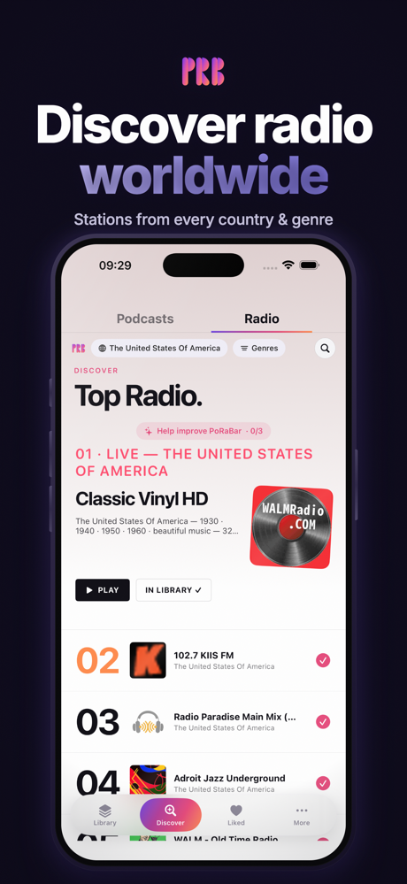

# PoRaBar: internet radio, podcasts and Audiobookshelf for iPhone and Mac

PoRaBar is one player for internet radio, podcasts, YouTube livestreams and your own
[Audiobookshelf](https://www.audiobookshelf.org) library. On the Mac it lives in the menu bar. On the iPhone
it is a normal app. Stations, shows and where you stopped follow you between the two.

**This repository is for bug reports, feature requests and feedback.** The app itself is not open source.

- [Download for iPhone](https://apps.apple.com/app/porabar/id6761472273) (iOS 17 or later)
- [Download for Mac](https://apps.apple.com/app/porabar/id6761472273?mt=12) (macOS 14 or later)
- Website: [porabar.com](https://porabar.com)

  
  
  

## Audiobookshelf

- Connect your own Audiobookshelf server and listen to your whole library, not just the newest books.
- Search by title, author, narrator or series.
- An Authors page with photos and biographies, with every book by that author.
- Continue Listening uses the progress your server already has. Your position is written back while you
  listen, so you can stop on one device and carry on with another.
- Covers keep their real shape, square or portrait.
- Hide radio, podcasts or YouTube and PoRaBar becomes a focused Audiobookshelf player.

## Internet radio

- Thousands of free stations from every country and genre, from the community directory
  [radio-browser.info](https://www.radio-browser.info).
- A Discover tab with the top stations where you are, plus picks based on what you listen to.
- Add any station to your library in one tap.

## Podcasts and YouTube

- Follow shows, with offline listening, likes and a queue. Progress and favorites stay in sync.
- Add YouTube videos, livestreams and playlists and listen to them as audio, without a video window.

## On the Mac

- Lives in the menu bar, one click from anywhere. A Dock icon only while a window is open, and you can turn
  that off.
- Sleep timer, AirPlay and a choice of output device.
- Hand off playback between your iPhone and your Mac.

## Price

The download is free and includes a 60-day free trial. After that, the full app is a one-time in-app
purchase ($2.99 in the US store; local prices differ). One purchase covers iPhone and Mac. There is no
subscription. After the trial, radio plays 5 minutes per session and podcasts are locked until you buy it.

You can also earn it for free: improve three stations in the directory (a logo, the country or the tags,
from the ⓘ button on a station). Once three stations are approved, the full app is yours.

## Questions people ask

**Is PoRaBar an Audiobookshelf client for the Mac?**
Yes. The Mac version connects to your Audiobookshelf server just like the iPhone version, with the same
library, search, Authors page and synced progress.

**Do I need an account?**
Not for PoRaBar. For audiobooks you sign in to your own Audiobookshelf server.

**Is there a subscription?**
No. A one-time purchase, after a 60-day free trial.

**What language is the app in?**
The app itself is in English. The radio stations come from every country.

## Feedback

- Found a bug? [Open a bug report](../../issues/new?template=bug_report.yml).
- Missing something? [Suggest a feature](../../issues/new?template=feature_request.yml).
- Rather send an email? support@porabar.com

Privacy policy: [porabar.com/privacy](https://porabar.com/privacy)
